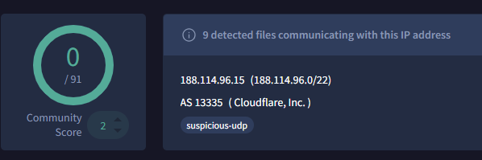
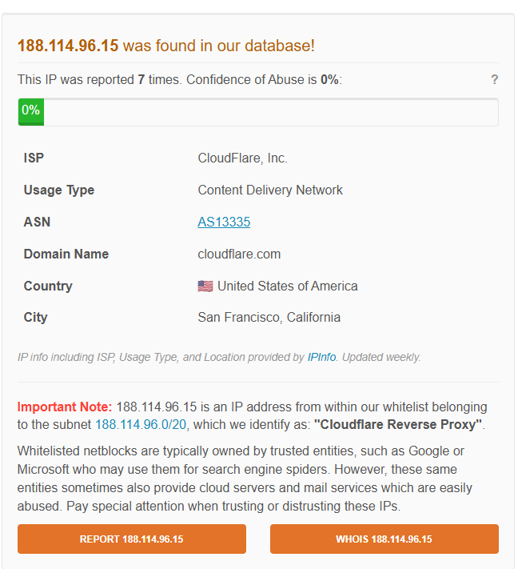
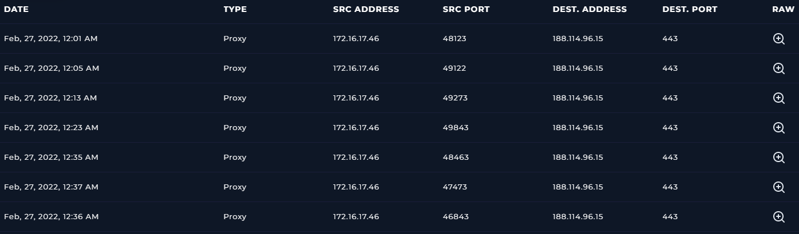

# SOC167 - LS Command Detected in Requested URL

## Alert
```plaintext
EventID : 117
Event Time : Feb, 27, 2022, 12:36 AM
Rule : SOC167 - LS Command Detected in Requested URL
Level : Security Analyst
Hostname : EliotPRD
Destination IP Address : 188.114.96.15
Source IP Address : 172.16.17.46
HTTP Request Method : GET
Requested URL : https://letsdefend.io/blog/?s=skills
User-Agent : Mozilla/5.0 (X11; Ubuntu; Linux i686; rv:24.0) Gecko/20100101 Firefox/24.0
Alert Trigger Reason : URL Contains LS
Device Action : Allowed
```

## Findings

- **Destination IP reputation:** VirusTotal, AbuseIPDB, and Cisco Talos associated the destination IP with Cloudflare. The reputation information reviewed did not indicate malicious activity.
- **HTTP traffic:** Seven proxy log entries associated with the source IP were reviewed. All were directed to the same destination IP and involved requests to the LetsDefend blog.
- **Triggering request:** The requested URL contained the query parameter `s=skills`. The detection rule matched the `ls` character sequence within `skills`, rather than identifying a standalone `ls` command.
- **HTTP response:** The triggering request returned HTTP 200.
- **Surrounding activity:** The requests immediately before and after the alert were consistent with browsing other LetsDefend blog articles.
- **Additional traffic:** No other destination IPs or suspicious requests were identified in the reviewed HTTP logs.

## Investigation Summary

### Timeline of Events

*February 27, 2022 (timezone not specified)*

- **12:00 AM:** Last user logon time recorded for host EliotPRD.
- **12:01 AM:** HTTP GET request to the LetsDefend blog homepage.
- **12:05 AM:** HTTP GET request to the "How to Become a SOC Analyst" blog article.
- **12:13 AM:** HTTP GET request to the "How to Analyze RTF Template Injection Attacks" article.
- **12:23 AM:** HTTP GET request to the "Red Team vs Blue Team" article.
- **12:35 AM:** HTTP GET request to the "How to Prepare SOC Analyst Resume" article.
- **12:36 AM:** Alert triggered by a GET request to `https://letsdefend.io/blog/?s=skills`.
- **12:37 AM:** Subsequent GET request to the "SOC Analyst Career Without a Degree" article.

On February 27, 2022, at 12:36 AM (timezone not specified), host EliotPRD (`172.16.17.46`) triggered an alert while making an outbound HTTP GET request to the LetsDefend blog, served through destination IP `188.114.96.15`.

The alert was generated by a detection rule looking for the `ls` command in requested URLs, which can indicate a possible command injection attempt. I reviewed the destination IP's reputation and ownership information using VirusTotal, AbuseIPDB, and Cisco Talos. The available information associated the IP with Cloudflare and did not indicate malicious activity.

<kbd>
    
</kbd>

<kbd>
    
</kbd>

&nbsp;

I then examined the HTTP proxy logs associated with the source IP to determine whether the triggering request was part of a broader suspicious pattern. Seven requests were reviewed, all directed to the same destination and involving pages on the LetsDefend blog.

<kbd>
    
</kbd>

&nbsp;

The triggering request contained the search query `s=skills`. The rule matched the `ls` character sequence within `skills`, rather than identifying a standalone command or apparent command-injection payload. The surrounding requests were consistent with normal browsing activity, and no other suspicious requests were identified in the reviewed logs.

The available evidence indicates that the alert was caused by an overly broad matching condition rather than malicious activity.

## Analyst Assessment

**Rule execution**: Correct. The rule triggered according to its configured matching criteria.

**Underlying activity**: Benign.

**Verdict**: False Positive.

The detection rule matched the characters `ls` within the word `skills` in the URL query parameter, not as a standalone command or apparent command-injection payload. Review of the available HTTP logs did not identify evidence of command injection or other malicious activity associated with this alert.

The investigation supports a false-positive classification for this event. This assessment is limited to the available proxy and threat-intelligence data; it does not establish that no other suspicious activity occurred outside the reviewed telemetry.

## Recommendations

1. **Tune the detection rule:** Update the matching criteria to identify `ls` in a command-execution context rather than matching the character sequence anywhere in a URL. Account for relevant command arguments, flags, and common encoding variations.
2. **Validate the revised rule:** Test against both legitimate URLs containing the substring `ls` and representative command-injection patterns to reduce false positives without overlooking relevant activity.
