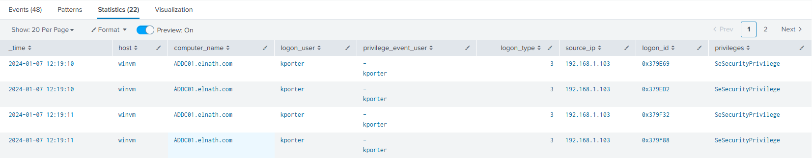
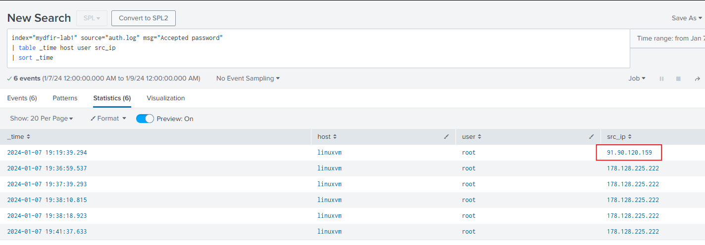
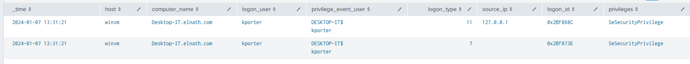

# Day 30 - Splunk Report Creation: Windows Administrative Logins

## Overview

For Day 30 of the MYDFIR SOC Accelerator, the task was to create a scheduled Splunk report that identifies successful Windows logons associated with administrative privileges.

The report was to run daily at 2 AM, searching the previous day's data. It also needed to exclude SYSTEM and computer accounts and display the login time, user, and computer.

I wanted to go a step further than simply finding successful logons. My approach was to correlate Windows Security Event IDs 4624 and 4672 using their Logon IDs. This would provide additional context by identifying successful logon sessions associated with special privilege assignments.

## Investigation and Approach

Before building the report, I researched the relevant Windows Security events.

Two event IDs were particularly important:

- **Event ID 4624:** A user successfully logged on to a computer.
- **Event ID 4672:** Special privileges were assigned to a new logon.

Event ID 4672 is especially useful because it identifies logon sessions associated with sensitive privileges. However, it does not necessarily mean that an account was elevated at that moment. It records the assignment of special privileges to the session.

I also reviewed Windows logon types to better understand the context of successful logons, including interactive, network, batch, service, and remote interactive logons.

My goal was to correlate the two event types so that the report would show which successful logon sessions were associated with special privilege assignments.

## Technical Implementation

### Windows: Correlating Events 4624 and 4672

I started by searching for both event types and examining their available fields.

I needed to use different field sources for the Logon ID depending on the event:

- Event 4624, use `Logon_ID`.
- Event 4672, use `Subject_Logon_ID`.

I used Splunk's `eval` command to normalize these fields into a common `logon_id` field. The logic simply uses the Logon_ID value if the EventCode value is 4624. otherwise use Subject_Logon_ID value.

```spl
| eval logon_id=if(EventCode=4624, Logon_ID, Subject_Logon_ID)
```

This allowed me to use the Logon ID as the common key when correlating the two event types.

I then used `stats` to group events by host and Logon ID, followed by `mvfind` to retain only sessions containing both Event IDs.

Another adjustment I made was to group by `host` and `logon_id` rather than including `_time` in the grouping. Including the timestamp could separate events belonging to the same session if their timestamps differed.

After refining the query and accounting for the field names in my dataset, my final SPL was:

```spl
index="mydfir-lab1" host=winvm sourcetype=WinEventLog (EventCode=4624 OR EventCode=4672)
| eval logon_id=if(EventCode=4624, Logon_ID, Subject_Logon_ID)
| eval account=if(EventCode=4624, user, Subject_Account_Name)
| where account!="SYSTEM" AND NOT like(account,"%$")
| stats
    values(EventCode) as event_code
    values(user) as logon_user
    values(Subject_Account_Name) as privilege_event_user
    values(Logon_Type) as logon_type
    values(src_ip) as source_ip
    values(Privileges) as privileges
    values(ComputerName) as computer_name
    earliest(_time) as _time
    by host logon_id
| where mvfind(event_code, "4624")>=0 AND mvfind(event_code, "4672")>=0
| table _time host computer_name logon_user privilege_event_user logon_type source_ip logon_id privileges
| sort 0 _time
```

The query performs the following:

1. Searches for successful logons and special privilege assignments.
2. Excludes SYSTEM and computer accounts.
3. Extracts the appropriate Logon ID from each event.
4. Groups events by host and Logon ID.
5. Keeps only sessions containing both Event IDs.
6. Displays the relevant account, computer, session, logon type, source IP, and privilege information.
7. Sorts the results chronologically, with the earliest first.

### Creating and Scheduling the Report

I saved the search using the requested report title:

**Daily - Windows - Successful Administrative Logins**

The report description was:

"Daily report that reviews the successful administrative logins that occurred the day before. The report identifies successful Windows logon sessions (4624) associated with special privilege assignments (4672), correlates the two event types using Logon ID, and presents the results for an analyst to review."

I configured the report to run every day at 2 AM, using the previous day's data.

The resulting report provides a recurring view of successful Windows logon sessions associated with special privilege assignments.

<kbd>
  
</kbd>

### Additional Exploration: Linux Successful Logins

Although the assigned exercise focused on Windows, I decided to explore how I could approach a similar reporting task using Linux authentication logs.

I researched relevant authentication messages and found that successful SSH logins could be identified using the `Accepted` message.

After examining the available fields, I narrowed the search to successful password-based SSH authentication:

```spl
index="mydfir-lab1" source="auth.log" msg="Accepted password"
| table _time host user src_ip
| sort _time
```

This produced six results.

<kbd>
  
</kbd>

One observation that stood out was a successful root login from a different source IP. Assuming the other IP was the legitimate address expected to access the host, this was worth investigating further.

I created a separate Linux report as a personal exercise. I did not include it in my assigned submission because it was outside the scope of the Windows reporting task.

## Findings and Results

The Windows report successfully correlated Event IDs 4624 and 4672 using Logon ID, allowing me to review privileged logon sessions rather than treating successful logons and privilege assignments as unrelated events.

One example involved the account `kporter`, which appeared in two separate sessions on the same host at the same timestamp.

The sessions had different Logon IDs and different logon types:

<kbd>
  
</kbd>

- Logon Type 11: Cached interactive logon.
- Logon Type 7: Workstation unlock.

Both were associated with `SeSecurityPrivilege`, a sensitive privilege that allows management of the security audit log.

This was a useful reminder that identical timestamps do not necessarily mean two events belong to the same session. The Logon ID provides the additional context needed to distinguish them.

The Linux exploration also demonstrated how a simple search can surface successful root SSH logins that may warrant further investigation.

Neither report establishes malicious activity on its own. They provide useful starting points for reviewing privileged access and identifying activity that may need additional context.

## Takeaways

This exercise reinforced several important Splunk and Windows security concepts:

- **Event correlation:** Event IDs 4624 and 4672 become more meaningful when correlated using Logon ID.
- **SPL development:** I gained more experience using `eval`, `stats`, `mvfind`, and conditional filtering to transform and correlate events.
- **Windows authentication:** Understanding logon types and the distinction between Subject and Target account fields is important when interpreting Windows Security events.
- **Scheduled reporting:** Reports can provide recurring visibility into security activity without requiring analysts to manually run searches every day.
- **Cross-platform investigation:** Exploring Linux authentication logs helped me recognize that similar security objectives can require different search approaches depending on the available telemetry.

One of my biggest takeaways was the importance of understanding the underlying event structure before attempting to correlate data. Knowing which fields represent the account, session, and privilege assignment made the difference between simply displaying events and producing a report with meaningful investigative context.

## References
- https://learn.microsoft.com/en-us/previous-versions/windows/it-pro/windows-10/security/threat-protection/auditing/basic-audit-logon-events
- https://www.ultimatewindowssecurity.com/securitylog/encyclopedia/event.aspx?eventID=4672
- https://lantern.splunk.com/Security_Use_Cases/Security_Monitoring/Managing_*nix_system_user_account_behavior/Successful_logins_to_a_*nix_server
- https://lantern.splunk.com/Security_Use_Cases/Security_Monitoring/Managing_*nix_system_user_account_behavior/Use_of_sudo_commands_on_a_server
- https://lantern.splunk.com/Security_Use_Cases/Security_Monitoring/Managing_*nix_system_user_account_behavior
- chatGPT for SPL query assistance

**Next step:** Continue developing my SPL skills and explore how these reports could be expanded into detections that alert analysts to unusual or potentially unauthorized privileged access.
